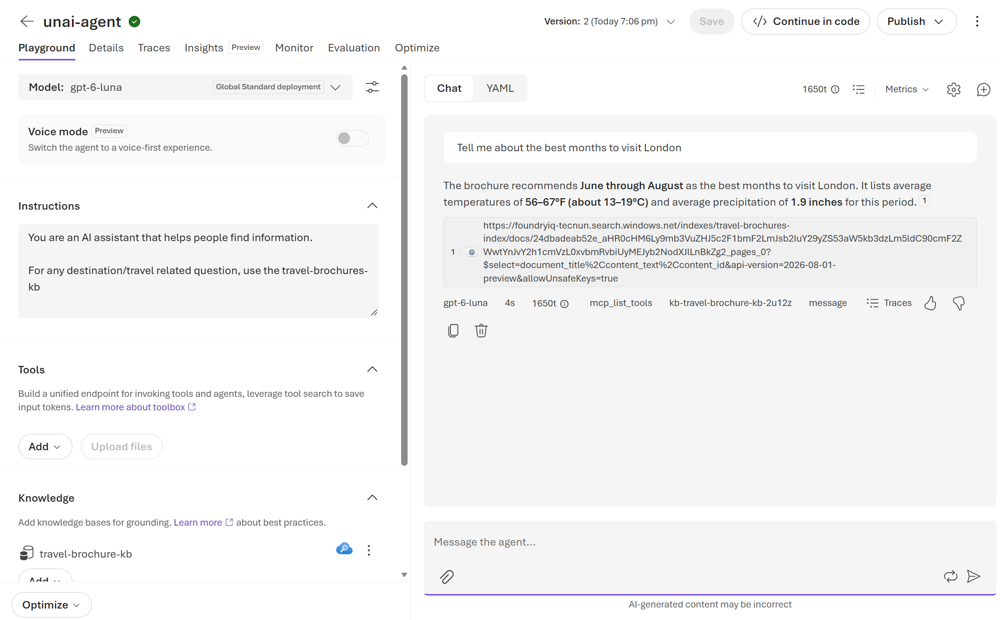

# Microsoft Foundry Labs

# Introduction to Microsoft Foundry

## Scenarios Covered
- TASK 1 - Setting up Microsoft Foundry
- TASK 2 - Exploring the Model Catalog
- TASK 3 - Model Deployment
- TASK 4 - Understanding GPT models using Playground
    - Training Data
    - Conversation History
    - System Message
    - Parameters
- TASK 5 - RAG (Retrieval Augmented Generation) with Microsoft Foundry
- TASK 6 - Exploring tools and token consumption
    - 6.1 Web Search
    - 6.2 Code Interpreter
- TASK 7 - Python App 

### EXERCISES TO BE UPLOADED
For each exercise, include the results in your submission document. Upload the results to the doc you will  upload to ADI.

### TASK 1 - Setting up Microsoft Foundry

In this task you will see the Azure AI Foundry that has been set up for you. You will also see the models that have been deployed to this Foundry.

If you open the Azure Portal (https://portal.azure.com) and navigate to the resource group `rg-foundry-unav`, you will see a resource called `foundry-tecnun-resource`. This is the Microsoft Foundry resource that has been set up for you.

Open the resource and expand all the options on the left column. You will see the following options:

- **Overview**: This is the overview of the Microsoft Foundry resource. You can see the location, resource group, subscription, region and other details about the resource.
    

- **Access Control (IAM)**: This is where you can manage access to the Microsoft Foundry resource. You can add or remove users and assign roles to them.

    > NOTE: You have been given the **Azure AI User** role for this resource. You will be able to use the models deployed to this Foundry, but you will not be able to manage the resource.

- **Keys and Endpoint**: This is where you can find the keys and endpoint for the Microsoft Foundry resource. You will need these to connect to the Foundry from your application.

- **Networking**: This is where you can manage the networking settings for the Microsoft Foundry resource. You can configure virtual networks, private endpoints, and other networking settings.

- **Monitoring**: This is where you can monitor the Microsoft Foundry resource. You can view metrics, logs, and other monitoring data.

From the overview page, click on the link to the Foundry Portal (https://ai.azure.com). This will take you to the Microsoft Foundry portal.

The Foundry can be used for several scenarios, including:
- Model Management: You can deploy, manage, and monitor AI models in a centralized location.
- Playground: You can test and evaluate different AI models and configurations.
- Projects: You can create projects to organize and manage your AI models and resources.
- Fine Tuning: You can fine-tune pre-trained models to better suit your specific use cases.
- Evaluation: You can evaluate the performance of your AI models using various metrics and benchmarks.
- More....

In this lab, we will focus on the **Model Catalog** and **Playgrounds** sections of the Foundry.

### TASK 2 - Exploring the Model Catalog

In this task, you will explore the Model Catalog in the Microsoft Foundry portal. The Model Catalog is where you can find all the AI models that have been deployed to the Foundry.

Click on the **Discover > Models** option in the left column. You will see a list of all the models that have been deployed to the Foundry.

You will see Foundry offers so many different types and providers of models:

- Providers like: Azure OpenAI, Microsoft, Hugging Face, Cohere, etc.
- Types like: Chat, Text Generation, Embeddings, Image Generation, etc.

**Explore Foundry Models**

Models sold by Azure are also hosted by Azure and operated by Azure as part of the Foundry Models service. They include all Azure OpenAI models and specific, selected models from top providers. These models are billed through your Azure subscription, covered by Azure service-level agreements, and supported by Microsoft.

Here for example you can find the details for OpenAI models offered within Foundry: https://learn.microsoft.com/en-us/azure/foundry/foundry-models/concepts/models-sold-directly-by-azure?pivots=azure-openai#azure-openai-in-microsoft-foundry-models

**Model Leaderboards**

The leaderboards help you compare models across multiple dimensions so you can choose the right model for your use case. Here are some guidelines for interpreting the results:

- **Quality index**: A higher quality index indicates stronger overall performance across reasoning, coding, math, and knowledge tasks. Compare the quality index across models to identify top performers for general-purpose language tasks.
- **Safety scores**: Lower attack success rates indicate more robust models. Consider safety scores alongside quality scores, especially for customer-facing applications where harmful output is a significant concern.
- **Performance trade-offs**: Use the latency and throughput metrics to understand the real-world responsiveness of a model. A model with high quality but high latency might not suit real-time applications.
- **Cost considerations**: The estimated cost metric uses a three-to-one input-to-output token ratio. Adjust your expectations based on your actual workload's input-to-output ratio.
- **Scenario leaderboards**: If your use case maps to a specific scenario (for example, coding or math), start with the scenario leaderboard to find models optimized for that task rather than relying solely on the overall quality index.

Go to the leaderboard. Identify the information for **GPT-6-Luna**. It offers really good performance for the cost. We will use this one during the labs.

#### TASK 2 - EXERCISE 1

Now go back to the Models tab and open the **compare models** option. 

Compare the following GPT 6 models side by side [GPT-6 models](https://learn.microsoft.com/en-us/azure/foundry/foundry-models/concepts/models-sold-directly-by-azure?pivots=azure-openai#gpt-6)

> ACTION! **Take a screenshot** of the comparison chart for the three GPT models. Upload the results to the doc you will  upload to ADI. **The picture must show the USERNAME/EMAIL to be taken as VALID**. 

### TASK 3 - Model Deployment

In this task, you will review model deployment concepts and use an existing deployment of **GPT-6-Luna** (model ID: `gpt-6-luna`) in the shared lab environment.

> IMPORTANT: **Do not create a new deployment or modify the shared deployment.** Use the instructor-provided deployment with your assigned **Azure AI User** role. Creating or managing deployments requires additional permissions; do not request role changes for this task.

1. Open [Microsoft Foundry](https://ai.azure.com) and make sure the **New Foundry** toggle is on. These steps use **Foundry (new)**, not the classic portal. Select the lab project associated with `foundry-tecnun-resource` in resource group `rg-foundry-unav`. If you cannot identify the project, ask your instructor rather than creating one.

2. Select **Discover** in the upper-right navigation, then **Models** in the left pane. Search for `gpt-6-luna` and open its model card. Confirm the model ID and review its capabilities. The catalog describes available models; it is not the list of deployments in your lab resource. 

3. Go to **Buil>Models** and and select the **existing `gpt-6-luna`** deployment. Review the settings of the deployment clicking on **Details** . They are configured by the instructor, not changed by students:

    - **Deployment name**: The name used to route requests to a particular deployment. It can differ from the catalog model ID; API examples use the deployment name in the `model` parameter.
    - **Model version**: The version selected for the deployment. Read the actual version in the lab deployment rather than assuming it from the model name.
    - **Deployment type**: Determines data-processing location, billing model, and performance characteristics. Supported options depend on the model and region.
    - **Tokens per minute (TPM)**: A throughput/quota allocation, not a spending cap. Usage can still incur charges.
    - **Model Guardrails**: Safety controls for prompts and generated content. Leave the shared deployment's configuration unchanged.

### TASK 4 - Understanding GPT models using Playground

In this task, you will use the model playground for the existing **GPT-6-Luna** deployment (model ID: `gpt-6-luna`) from Task 3. You will explore training data, conversation history, instructions, and parameters.

1. In [Microsoft Foundry](https://ai.azure.com), keep **New Foundry** enabled and select the lab project associated with `foundry-tecnun-resource` in `rg-foundry-unav`.
2. Select **Build > Models**, then select the existing deployment from Task 3 to open its playground. Confirm its deployment name and underlying model; the deployment name can differ from `gpt-6-luna`.
3. Use the **Playground** pane to review the system prompt/instructions and available parameters. Change only your playground request settings, not the deployment, model guardrails, or shared infrastructure. **Do not save an agent or create resources for these exercises**.
4. Start a fresh chat before each independent comparison, retaining the same deployment. Verify the instructions and parameter values before each run. Keep tools, web search, and external knowledge out of these tests so you can examine the model and supplied context alone. If the required controls are unavailable or would change shared configuration, ask your instructor before proceeding.
5. Lets keep all the Playground setup clean. **Please delete any Tools (like websearch) enabled**.

Responses can vary. Compare what actually happens rather than expecting the exact wording of a sample answer. Upload the results to the doc you will  upload to ADI. Keep your **USERNAME/EMAIL** visible, but do not include API keys, tokens, or other credentials.

#### TASK 4 -  1 Training Data

Training data helps a model learn patterns and general knowledge. A training-data cutoff is not a guarantee that the model knows every earlier fact or that all its answers are correct. A model can also use information supplied in the current conversation; without retrieval tools, it cannot independently check live sources.

1. Check the deployed model version from Task 3 and find its documented training-data cutoff in the [GPT-6 model table](https://learn.microsoft.com/en-us/azure/foundry/foundry-models/concepts/models-sold-directly-by-azure?pivots=azure-openai#gpt-6). Do not use the model's description of its own cutoff as evidence.
2. In a fresh chat without tools or external knowledge, ask a time-sensitive question about an event after that cutoff. For example: "What was the last game of Real Sociedad? State what you cannot verify."
3. Independently check an authoritative, dated source outside the playground. Compare the answer with that source: is it correct, outdated, unsupported, or explicit about uncertainty? Record the event date and source in your submission evidence. A correct answer to one question does not prove access to current information.

Web search and retrieval-augmented generation (RAG) can supply more recent or private information as context. They are separate from the model's original training and will be explored later. Check the model training date here [model details](https://learn.microsoft.com/en-us/azure/foundry/foundry-models/concepts/models-sold-directly-by-azure?pivots=azure-openai#capabilities-2)

#### TASK 4 - EXERCISE 1
Try your own time-sensitive question. Capture the prompt, response, and your comparison with a dated authoritative source, including any uncertainty or error. Upload the results to the doc you will  upload to ADI. **The picture must show the USERNAME/EMAIL to be taken as VALID**.

#### TASK 4 - 2 Conversation History 

Conversation history supplies context for later turns. Referring to an earlier message is not the same as permanently learning a fact or changing the model's weights. Applications can supply history again or use API-managed conversation state; this is separate from an agent's persistent memory.

1. Start a fresh chat with neutral instructions. Send: "For this conversation, my fictional project code is TECNUN-742."
2. In the same chat, ask: "What is my fictional project code?" The model should usually be able to use the earlier message to answer.
3. Start another fresh chat with the same deployment and neutral instructions. Do not copy the code into the new chat or instructions. Ask: "What is my fictional project code?"
4. Compare the responses. Without the earlier context, the model has no reliable basis for knowing that code. A guess is not evidence of memory; if it repeats the code, check whether prior context or instructions were retained.

#### TASK 4 - EXERCISE 2
Try your own fictional fact and compare a follow-up in the same chat with the same question in a fresh chat. Capture both results. Upload the results to the doc you will  upload to ADI. **The picture must show the USERNAME/EMAIL to be taken as VALID**.

#### TASK 4 - 3 System Message

System instructions describe the assistant's task, behavior, and expected output.  Do not assume that every model uses identical message roles or parameters.

1. In a fresh chat, use neutral instructions: "You are a helpful assistant."
2. Send: "The food was disappointing and the service was slow." Record how the model responds without a specific task.
3. In the **Setup** pane, replace the system prompt/**instructions** with: "Classify restaurant reviews. Reply with exactly one label: Positive, Neutral, or Negative. Do not add an explanation." Apply the edit if the interface asks you to, and start a fresh chat with these instructions.
4. Send the same review. Check whether the response follows the classification task and requested format. The intended label is `Negative`, but instruction following must be evaluated rather than assumed.

*Legacy illustration of an instruction-based comparison. Its controls and model output are not a reference for the current portal.*

**Types on messages in model request**:
| Type | Description |
|------|-------------|
| system message | Instructions for the assistant, defining its behavior and expected output. |
| user message | Input from the user, including questions, prompts, or tasks. |
| assistant message | Response from the assistant based on the system and user messages. |

#### TASK 4 - EXERCISE 3
Create your own instruction-based task and compare the same input with neutral and task-specific instructions. Include the instructions and results. Upload the results to the doc you will  upload to ADI. **The picture must show the USERNAME/EMAIL to be taken as VALID**.

#### TASK 4 - 4 Parameters

Parameters affect generation, but the available controls depend on the deployed model version and API. Review the [reasoning-model guidance](https://learn.microsoft.com/en-us/azure/foundry/openai/how-to/reasoning) and the parameters exposed in **Setup**. Do not assume that a parameter from an older GPT playground is supported here.

- **Max Completion tokens**: An upper bound, not a target length. For reasoning models, the generation budget includes reasoning tokens as well as visible output. The API parameter is `max_output_tokens` for Responses or `max_completion_tokens` for Chat Completions; do not copy the older `max_tokens` parameter into reasoning-model calls.
- **Reasoning effort**: Controls how much reasoning work a model can perform. Supported values and defaults vary by model; use only values offered for this deployment. More reasoning can increase latency and token usage without guaranteeing a better answer.
- **Verbosity** (not in playground): Influences answer detail where supported. It is not a hard token cap.
- **Temperature / Top P** (not in playground): Sampling controls where supported. Do not infer support from another reasoning model, and do not change both in the same comparison. Lower randomness does not guarantee correctness or identical responses.

Try the following controlled comparison:

1. Restore neutral instructions and note the current parameter values. 
2. In a fresh chat, set the output-token limit to **1000**, if accepted, and send: "Write a detailed guide to planning a university engineering project, covering requirements, design, testing, risks, and delivery."
3. In another fresh chat, change only that limit to **100**, if accepted, and send the identical prompt. Keep instructions and other parameters unchanged.
4. Compare completeness and visible output. If shown, record token usage and completion status. A low budget can be consumed by reasoning before any visible answer appears; an empty or truncated response is a valid observation, not proof that the playground is broken. If a value is rejected, record the error rather than repeatedly retrying or changing the deployment.
5. Restore your original playground settings and neutral instructions before continuing to Task 5.

Use only a few controlled runs: playground requests consume tokens and can incur charges. Never increase the deployment's TPM allocation or change its guardrails for this experiment.

#### TASK 4 - EXERCISE 4
Try your own prompt with two values of one supported parameter (max tokens). Include the parameter name, values, and observed results, including any truncation or error. Upload the screenshot to the doc you will  upload to ADI. **The picture must show the USERNAME/EMAIL to be taken as VALID**.

Microsoft Learn references (verified **2026-10-30**):
- [Microsoft Foundry model playground](https://learn.microsoft.com/en-us/azure/foundry/concepts/concept-playgrounds#model-playground)
- [GPT-6 model IDs, versions, capabilities, and training-data cutoffs](https://learn.microsoft.com/en-us/azure/foundry/foundry-models/concepts/models-sold-directly-by-azure?pivots=azure-openai#gpt-6)
- [Azure OpenAI reasoning models: API support, instructions, and token budgets](https://learn.microsoft.com/en-us/azure/foundry/openai/how-to/reasoning)

### TASK 5 - RAG (Retrieval Augmented Generation) with Microsoft Foundry

What is RAG?

RAG (Retrieval Augmented Generation) is a technique that combines the power of large language models (LLMs) with **external knowledge sources** to improve the quality and relevance of generated content. By integrating retrieval mechanisms into the generation process, RAG enables LLMs to access and utilize specific information from external databases, documents, or other resources, resulting in more accurate and contextually appropriate outputs.

Basically when custom data is needed to answer a question, RAG is used to retrieve the relevant information from an external source and provide it to the LLM to generate a more accurate response.

These are steps followed by a tipical RAG architecture:
1. **User Input/Question**: The user submits a query or question to the system.
2. **Retrieval**: The system uses a retrieval mechanism (like a search engine or a vector database) to find relevant documents or information from an external knowledge source based on the user's input.
    >NOTE: For our lab we will use an **Azure Search** resource as the external knowledge source.
3. **Augmentation**: The retrieved documents or information are then combined with the user's input. Basically we send 2 inputs to the Gen AI model
    3.1 The user input/question
    3.2 The relevant information retrieved from the external source, the **relevant search results**.

On this labs we are going to Analyze each component of the RAG architecture and test it in practice using Microsoft Foundry.

### Task 5 - 1 - Components Involved in RAG

The main components involved in a RAG architecture are:
1. **Large Language Model (LLM) or SLM (Small Language Model)**: This is the core component of the RAG architecture. It is responsible for generating text based on the input it receives. In our case, we will use the `gpt-6-luna` model deployed in the Microsoft Foundry. **Already explained in previous tasks**.

2. **Data Index / Vector Database**: This component is responsible for retrieving relevant documents or information from an external knowledge source based on the user's input. In our case, we will use an **Azure Search** resource as the Data Index / Vector Database keeping our custom data

3. **Embedding Model**: This component is responsible for converting text into vector representations (embeddings) that can be used for similarity search. In our case, we will use the `text-embedding-3-small` model from Azure OpenAI to generate embeddings/vectors for our custom data.

### Task 5 - 2 - Azure Search Resource

In this task, you will explore the Azure Search resource (also known as FoundryIQ now in Microsoft Foundry) that has been set up for you. The Azure Search resource is used as the Data Index / Vector Database in our RAG architecture.

Lets imagine we are a travel agency. This travel agency for many years has been creating travel guides for different cities around the world. The travel guides are in PDF format and contain information about the city, including places to visit, restaurants, hotels, etc.

You can use the sample travel brochure provided in the workspace: [brochures/London Brochure.pdf](brochures/London%20Brochure.pdf)

Our PDF are considered **our RAW data**. In order to make this data searchable, we need to extract the text from the PDF and create an index in Azure Search. An index is a collection of documents that can be searched. Each document contains fields that can be searched and filtered.

Each document in the index will represent a section of the PDF. The fields in the document will represent the different attributes of the section, like:
- Title
- Content
- And many more fields that could be created for filtering/ordering purposes.

Go to the Azure Portal (https://portal.azure.com) and navigate to the resource group `rg-foundry-unav`, you will see a resource called `foundryiq-tecnun`. This is the Azure Search resource that has been set up for you.

Traditionally, searching engines have relied on **keyword-based search**, which can be limited in its ability to understand the context and meaning of the text. If a client was looking for **"Barcelona"**, a keyword-based search engine would only return documents with fields contain the exact word "Barcelona". It would not return documents that contain synonyms or related terms, like "Catalonia" or "Sagrada Familia".

**Vector Search** is a more advanced technique that uses machine learning to understand the context and meaning of the text. It **converts the text into vector** representations (embeddings) that can be used for similarity search (cosine similarity, similarity between vectors). This allows the search engine to return documents that are **similar in meaning, even if they do not contain the exact keywords**.

For the exercise we have taken those RAW PDF travel agency brochures and created an index in the Azure Search resource. The 4 original brochures have been stored in a storage account , processed and indexed. The index is called `travel-brochures-index`. You can see the index by clicking on the **Indexes** option in the left column in the Azure Portal of the Azure Search resource.

Open the index, you will see the **fields** that have been created for the index. The most important fields are:
- **content_text**: This field contains the text content of the section.
- **document_title**: This field contains the title of the source document, such as `London Brochure.pdf`.
- **content_embedding**: This field contains the vector representation (embedding) of the text content. **This field is used for vector search**.

Reference: [Microsoft Learn: Extract, chunk, and embed multimodal content](https://learn.microsoft.com/azure/search/tutorial-multimodal) (field structure verified on November 1, 2026).

Lets try keyword-based search directly from the Portal. Click on the **Search explorer** option in the left column. This is where you can test the search capabilities of the Azure Search resource. Look for "London".

We can see the search return the London PDF brochure as the top result, as it contains the keyword "London". 

Lets understand why RAG is adding value here: is not only about finding information using vector search/comparison, is also about using a LLM to generate a more human-like response based on the information retrieved.

### Task 5 - 3 - Embedding Model

In this task, you will explore the embedding model that has been set up for you. The embedding model is used to convert text into vector representations (embeddings) that can be used for similarity search.

Azure search has been configured to use the `text-embedding-3-small` model from Azure OpenAI to generate embeddings/vectors for our custom data. Our questions will also be converted to vectors using the same embedding model, so we can compare the vectors and find the most relevant documents.

### Task 5 - 4 Test without RAG

Go to the Microsoft Foundry portal (https://ai.azure.com) and create a new Agent fromm the **Agents** section. Click on **New Agent>Build an agent**. Give it your own name, select "text mode" and click **Create**.

> NOTE: for this exercise we need to use the agent playground , instead of the model one. 

Before starting the test, delete **Web Search** from the agent configuration and make sure you are using "gpt-6-luna" as the model.

With the default configuration of the agent (no RAG components added - empty **Knowledge** section), try to ask a question related to the travel brochures, for example:
"Tell me about the best months to visit London"

You will see the model only provide a generic answer based on its training data.

### Task 5 - 5 - Putting it all together - RAG

Lets try all components together. We will use the Agent  Playground for the agent saved in the previous exercise. 

Click on **knowledge>Add>travel-brochure-kb**. Your teacher has already configured this knowledge base with the necessary data:
1. Uploaded RAW PDF documents to an Storage Account in Azure.
2. Configured the Azure AI Search index to use these documents for retrieval.
3. Connected the index to Foundry project as a knowledge base named `travel-brochure-kb`.

Next, modify the **Instructions** to include the following message for the agent:

_"Use the travel-brochure-kb knowledge base to answer questions related to travel brochures. Only provide information that is contained in the custom data."_

Now try the question again: "Tell me about the best months to visit London"

You can see the model is able to provide a  relevant answer **based on the custom data we have provided from AI Search**. 

The main difference between searching data directly in a index (no LLM/Agents) and implementing an agentic RAG solution is:  a search solution without LLMs would have given you the full unmodified text field (the full PDF section) as the answer (green in picture). With RAG, the LLM is able to generate a more human-like response based on the information retrieved, **giving you a focused answer** (information in the red section, reworded by model). 

Apart from the answer, RAG solutions can also be customized to **only return answers contained in the custom data** (no generic answers based on training data).

#### TASK 5 - EXERCISE 1
Try you own example question that reflects how RAG is used to provide relevant answers based on custom data. 

Take a look at the provided PDF brocures that have been indexed in Azure Search for ideas. You can see the PDFs in the repo folder [Brochures](Brochures)

Show a Agent Playground query that gives an answer citating the downloaded custom PDF documents. 
Upload the results to the doc you will  upload to ADI. **The picture must show the USERNAME/EMAIL to be taken as VALID**.

### Task 6 - Exploring tools

In this task, reuse the **agent you created in Task 5** to explore two travel-agency scenarios: finding current information with **Web Search** and analyzing travel budgets with **Code Interpreter**. Compare the results with and without each tool, and measure **token consumption**, not just the length of the visible answer.

**Before you start**

1. Open the same project in the current Microsoft Foundry portal (https://ai.azure.com), select your Task 5 agent from **Agents**, and open its **Agents playground**. Do not create another agent or use the Model playground.

2. Select the **existing deployment for `gpt-5.6-luna`** provided by your instructor. 

3. Temporarily detach the `travel-brochure-kb` knowledge attachment from **your agent only**, without deleting the knowledge base or its connection. Remove other tool attachments from your agent for the comparisons. This isolates each tool from the RAG retrieval tested in Task 5.
4. Temporarily replace the Task 5 brochure-only instructions with the following instructions, and save your agent configuration:

    _"You are a travel-agency assistant. Use Web Search for current public information when it is available, and cite your sources. If Web Search is unavailable, clearly state that current information has not been verified. Use Code Interpreter for budget calculations and charts when it is available. Distinguish executed code from an answer generated without execution. Keep explanations concise. If a tool fails, report the failure rather than claiming success."_

### Task 6.1 - Web Search

**Scenario:** A customer is planning a London visit and needs information that might have changed since the brochures were written.

1. With no tools attached, start a **new conversation** and send this prompt:

    _"What was the last game played by real sociedad?"_

1. Take a look at the toke usage for this interaction (below the response). Both the input and output you see should be a couple hundred tokens each, but you see the input is really high compared to the output. **Each web result given to the model contributes to the input token count, which explains the high usage!**

#### TASK 6 - EXERCISE 1

Run your own question using the same format as the example above. Observe the token usage and how the model handles the input.

Upload the example results to the doc you will upload to ADI. **The picture must show the USERNAME/EMAIL to be taken as VALID**. 

### Task 6.2 - Code Interpreter

**Scenario:** Your travel agency needs a reproducible budget comparison and a chart for a customer. The figures below are **fictional EUR prices**, not current web prices.

1. Detach Web Search from your agent, leave knowledge detached, and save the configuration. With no tools attached, start a **new conversation** and send this prompt:

    _"Compare these fictional EUR budgets for one traveler spending 4 days and 3 hotel nights. London: hotel 120 EUR/night, meals 35 EUR/day, attractions 45 EUR total. Paris: hotel 150 EUR/night, meals 40 EUR/day, attractions 60 EUR total. Madrid: hotel 95 EUR/night, meals 30 EUR/day, attractions 35 EUR total. Calculate each city's hotel, meals, and attractions subtotals and total, then add a 10% contingency. Use Code Interpreter to execute Python and generate a downloadable bar-chart image comparing the totals including contingency. Label the axis EUR, show the values, identify the cheapest option, and explain the calculation in no more than three bullets. If execution is unavailable, say so and do not claim to have run code or generated a file."_

2. You will see the model cannot generate chart (and usually models are also **not the best when it comes to precise calculations or visualizations without executing code**).
3. Attach **Code Interpreter** in your agent's tool configuration, with no other tools or knowledge attached, and save it. Start another **new conversation** and send the **exact same prompt**.
4. Now the solution should be **able to execute the Python code, generate the chart, and provide accurate calculations**.
5. Verify the calculations independently: before contingency, London should total **545 EUR**, Paris **670 EUR**, and Madrid **440 EUR**. With contingency, the totals should be **599.50 EUR**, **737 EUR**, and **484 EUR**, respectively. Madrid should be the cheapest. Report any incorrect calculation or failed execution.

#### TASK 6 - EXERCISE 2

Think about an scenario in which the code interpreter would be interesting to use and test its capabilities for executing Python code, generating visualizations, or performing precise calculations.

Upload the results to the doc you will upload to ADI. **The picture must show the USERNAME/EMAIL to be taken as VALID**. Include screenshots of the tool configuration, execution/chart results, and reported token usage; do not include keys or credentials.

#### Task 6.3 - Using MCP servers

On this task you will explroe the use of MCP servers for executing computational tasks, managing workloads, and integrating with your agent's capabilities.

1. Delete previous configurations related to tools and knowledge attachments in your agent.
2. Open the **Tools** section in your agent's configuration and select the option to add a new tool.
3. Click on Catalog option and filter by Remote MCP servers (MCP executed and maintained by provider). You will see an extensive list of available MCP server options, to be able to connect your agent to many services your team may use on their day to day.
1. In our case, we are going to try ´Microsoft Learn MCP'. This MCP server allows to ground answer based on the latest Microsoft Documentation content (much more eficient than relying on general web search).
1. Leave default settings to add the MCP Server
    - Endpoint: https://learn.microsoft.com/api/mcp
    - Authentication: None required for public documentation access

1. Modify the **instructions**, so that any Microsoft product related queries are directed to the Microsoft Learn MCP server for accurate and up-to-date documentation. Copy/paste: 

"
Please direct all Microsoft product related queries to the Microsoft Learn MCP server for accurate and up-to-date documentation.
"

1. Try the following prompt to test the Microsoft Learn MCP server integration:

"
What are the latest OpenAI models available in Foundry?
"

1. We may need to **Approve** the use of MCP tools. In our case the MCP is used to READ external data, but and MCP tool **could be used to CREATE/UPDATE external data as well, depending on its capabilities and permissions.**

1. Check the results and the token consumption reported for the request. **MCP are another integration point that may impact your agent's behavior and resource usage.**

#### Task 6.3 - EXERCISE 3

Think about an scenario in which the configured Microsoft Learn MCP server would be useful. Try the prompt. 

Upload the results to the doc you will upload to ADI. **The picture must show the USERNAME/EMAIL to be taken as VALID**. Include screenshots of the tool configuration, execution/chart results, and reported token usage; do not include keys or credentials.

